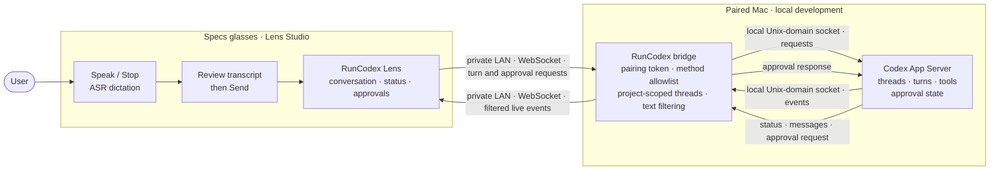

# RunCodex

**A spatial Codex companion for Specs.** RunCodex brings a project-scoped Codex conversation into the user's work area, so they can check progress, dictate a follow-up, and handle a real approval request without returning to a laptop screen.

The Lens uses a small world-locked launcher and an on-demand conversation panel. The panel stays at its chosen place as the user turns; a grab bar lets them move it when needed. It is designed as a glasses interface, not a web page floating in front of the face.

## What it does

- Shows the selected Codex task, live turn status, recent conversation, and completion response.
- Uses Specs speech recognition for **Speak / Stop** dictation. The user reviews the transcript before pressing **Send**.
- Streams Codex responses into a scrollable conversation viewport.
- Shows **Approve** and **Reject** only for a pending approval received from the live Codex connection.
- Keeps the panel hidden until the launcher is opened, and lets the user reposition the launcher and panel together.
- Includes a clearly marked sample flow for trying the interface without a live connection.

RunCodex does not include a custom virtual keyboard. Speech input availability depends on the Lens Studio Preview or Specs environment and its ASR permissions and network access.

## How the connection works



The bridge runs on the paired Mac. It is a development relay, not a hosted service or an unrestricted shell. It supports one paired Lens client, filters available threads to the configured project root, allows a limited set of Codex App Server methods, and forwards plain-text conversation content rather than tool output.

### Components and data flow

- **RunCodex Lens** — the Specs interface in Lens Studio. It owns the launcher, spatial panel, task status, conversation view, speech-to-text draft, and approval controls. The user reviews dictated text before sending it.
- **RunCodex bridge** — a small Node.js relay on the paired Mac. It authenticates the Lens with a local pairing token, exposes only the supported App Server methods, and keeps thread discovery scoped to `RUNCODEX_PROJECT_ROOT`.
- **Codex App Server** — the local Codex service reached by the bridge over its Unix-domain socket. It owns the thread, turn, tool execution, and approval state.

The live flow is:

1. The Lens pairs with the bridge, asks for the project's threads, and loads the selected thread's recent user and assistant messages.
2. The user dictates a follow-up, reviews the draft, and sends it. The Lens uses `turn/start` for a new turn or `turn/steer` to add to the active turn.
3. The App Server streams turn status and assistant text through the bridge. The bridge forwards bounded plain-text messages; the Lens updates the conversation as events arrive.
4. If the App Server requests approval, the bridge forwards that request to the Lens. **Approve** or **Reject** returns the decision for that request to the App Server, and the panel updates when it is resolved.

The bridge is a relay, not the agent runtime: it does not execute arbitrary commands, expose tool output, or host project data. Codex App Server remains responsible for running the task and applying its own approval and execution policies.

The bridge uses unencrypted WebSocket on a trusted local network. **Do not port-forward it or expose it to the public internet.** Keep the pairing token private and never put it in this README, screenshots, logs, or a public commit.

## Open the project

1. Install Lens Studio and Node.js on the Mac used for development.
2. Open [`Specs Base Template 2.esproj`](Specs%20Base%20Template%202.esproj) in Lens Studio. This is the current manifest filename; the Lens/product is named **RunCodex**.
3. Run the project in Lens Studio Preview. Without local bridge credentials, the Lens stays in sample mode and labels its content **SAMPLE DATA — NOT CONNECTED TO CODEX**.

The current Lens Studio project and manifest report Lens Studio **5.23.2** and `targetPlatform: Spectacles` (the editor enum for the **Specs** glasses platform). The Lens has also been run successfully in Preview with **SPECS 27** selected, according to participant testing. The Preview simulation target and the manifest's platform enum are separate settings; the manifest value does not contradict that Preview result. This is Preview verification, not a physical-device test. See [Snap's Preview target documentation](https://www.developers.snap.com/lens-studio/features/scripting/external-debugger).

## Run the local bridge

For live Codex use, run the bridge from the project directory on the Mac that can reach the intended Codex App Server socket:

```sh
RUNCODEX_PROJECT_ROOT="$PWD" \
RUNCODEX_BRIDGE_TOKEN="<private local pairing token>" \
node Assets/RunCodexBridge/bridge.mjs
```

The bridge listens on port `8765` by default. In Lens Studio, configure the `RunCodexUI` component with the bridge's reachable private-LAN WebSocket URL (`ws://<mac-lan-address>:8765/runcodex`) and the same private pairing token. Use a unique token for your own development setup; do not reuse a token from another checkout.

The bridge must also be able to reach the Codex App Server. Its default socket location is an implementation detail; if it is not available in your environment, set `CODEX_APP_SERVER_SOCKET` only to a socket path you have independently verified belongs to the intended App Server. Do not guess a socket path. See [`Assets/RunCodexBridge/README.md`](Assets/RunCodexBridge/README.md) for setup details and troubleshooting.

## Try the Lens

- Open **RunCodex** from the world-locked launcher.
- In live mode, choose **Speak**, dictate a message, choose **Stop**, review the transcript, then choose **Send**.
- Read user and Codex messages in the conversation viewport. Long messages can be scrolled without moving the panel or its controls.
- When the connected Codex task raises a real approval request, review it and choose **Approve** or **Reject**. Sample mode is labeled and does not represent a live Codex approval.
- Pinch and drag the bar beneath the panel to move the launcher and panel together.

User-confirmed in Lens Studio Preview: live Codex message sending and receiving, and handling real approval requests with **Approve** or **Reject**. This Preview verification does not establish behavior on physical Specs glasses; no physical-device verification is claimed here.

## Planning and implementation

- [`devpost/design-brief.md`](devpost/design-brief.md) — approved AR design brief.
- [`devpost/scope.md`](devpost/scope.md) — retrospective product scope.
- [`devpost/prd.md`](devpost/prd.md) — retrospective user stories and acceptance criteria.
- [`devpost/spec.md`](devpost/spec.md) — retrospective architecture and technical design.
- [`devpost/checklist.md`](devpost/checklist.md) — retrospective build checklist and verification limits.
- [`devpost/build-notes.md`](devpost/build-notes.md) — implementation and verification summary.
- [`devpost/two-way-codex-plan.md`](devpost/two-way-codex-plan.md) — conversation integration audit, plan, and verification notes.
- [`Assets/Scripts/RunCodexUI.ts`](Assets/Scripts/RunCodexUI.ts) — Lens interface, interaction, conversation, and approval handling.
- [`Assets/RunCodexBridge/bridge.mjs`](Assets/RunCodexBridge/bridge.mjs) — development-only local relay.
- [`project_notes.md`](project_notes.md) — local bridge troubleshooting notes.

The project was built in Lens Studio using the CLAD workflow and Lens Studio MCP. The design brief and implementation plan record the project planning; the scope, PRD, spec, checklist, and build notes linked above were reconstructed retrospectively from the current project. The repository includes LEAF scenario scripts for Preview workflows. The participant reports that the full RunCodex experience was exercised successfully in Lens Studio Preview with SPECS 27 selected.

## Status and limitations

- TypeScript compilation and Lens Studio Preview refresh have passed in the current development checkout.
- User-confirmed in Lens Studio Preview with SPECS 27 selected: the RunCodex experience works, including sending and receiving live Codex messages and handling a real approval request with **Approve** or **Reject**.
- Live use still depends on a correctly paired local Codex App Server and private-network bridge setup.
- The project targets the `Spectacles` platform enum in Lens Studio 5.23.2 and has been tested in Preview with **SPECS 27** selected. Physical Specs device behavior remains unverified.
