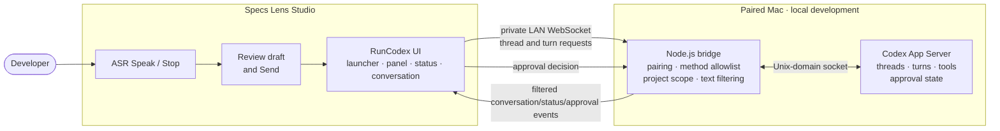

# Technical Spec

> Retrospective architecture record reconstructed on 2026-10-27 from the project files, README, and implementation notes. Validate version-specific API details against current official documentation before future migrations.

## Overview

RunCodex consists of a Lens Studio Specs Lens, a local Node.js WebSocket bridge on the paired Mac, and the Codex App Server reached through its local Unix-domain socket. The Lens owns the spatial interface and user review step. The bridge authenticates the Lens, constrains the supported methods and project threads, and filters forwarded content. The App Server owns conversation, tool execution, and approval state.

## Stack

- Lens Studio project targeting the Specs glasses platform; the live editor setting and manifest report the `Spectacles` target enum and Lens Studio 5.23.2. The participant reports successful Preview runs with SPECS 27 selected. Preview simulation selection is separate from the manifest's platform enum and does not claim physical-device testing.
- TypeScript Lens UI in `Assets/Scripts/RunCodexUI.ts`.
- Spectacles Interaction Kit and UIKit assets/packages for hand interaction and UI (package names retained as written).
- Specs ASR Module for speech-to-text; the user reviews text and explicitly sends it.
- Node.js bridge in `Assets/RunCodexBridge/bridge.mjs`.
- WebSocket on the private LAN between Lens and bridge; local Unix-domain socket between bridge and App Server.

## Architecture



The bridge is a local development relay, not the agent runtime. The design does not provide public hosting, arbitrary shell access, or tool-output forwarding. The bridge uses unencrypted WebSocket; users must keep it on a trusted private network and must not expose it to the public internet.

## File Structure

```text
Assets/
  Scene.scene                         Lens scene and authored component wiring
  Scripts/RunCodexUI.ts               Spatial UI, ASR, conversation, and approvals
  RunCodexBridge/bridge.mjs           Local WebSocket-to-App-Server relay
  RunCodexBridge/README.md            Bridge setup and troubleshooting
devpost/
  design-brief.md                     Product design brief
  scope.md                            Retrospective project scope
  prd.md                              Retrospective user-facing requirements
  spec.md                             Retrospective technical design
  checklist.md                        Retrospective build checklist
  build-notes.md                      Implementation and verification record
  two-way-codex-plan.md               Conversation feature audit and implementation notes
```

The public scene should not contain private pairing credentials. Configure connection values only in the local development setup; do not commit them.

## Data Flow

1. The Lens opens a WebSocket connection to the configured private-LAN bridge URL and authenticates with the locally configured pairing token.
2. The Lens requests project-scoped thread information. The bridge forwards supported requests to the App Server over its local socket.
3. The user dictates with ASR, reviews the transcript, and explicitly sends it. The Lens requests `turn/start` or, for an active turn, `turn/steer`.
4. The App Server emits turn and message events. The bridge filters the supported plain-text/status data and forwards it to the Lens, which updates the conversation view.
5. On an approval request, the App Server event is relayed to the Lens. The user's decision is sent back through the bridge for that request; the App Server remains authoritative for resolution.

## Components And Responsibilities

### RunCodex Lens UI

Implements: `prd.md > Epics 1-4`

- Owns launcher, spatial panel, task status, conversation history, composer, and approval controls.
- Uses Specs speech recognition to create a draft, then requires explicit user review and Send.
- Keeps long messages in a bounded viewport and displays connection/sample state.

### RunCodex bridge

Implements: `prd.md > Epic 5` and the transport portions of Epics 2-4.

- Runs locally on the paired Mac and accepts one paired Lens client.
- Authenticates using a private local pairing token.
- Scopes thread discovery to `RUNCODEX_PROJECT_ROOT`, restricts supported calls, and filters tool output.
- Relays supported request/response and event data between the Lens and App Server.

### Codex App Server

Implements: conversation and execution behavior used by `prd.md > Epics 2-4`.

- Owns threads, turns, tool execution, streamed events, and approval state.
- Is reached through the configured local socket; the participant reports that the SPECS 27 Preview connection worked. Other host environments need their own valid socket configuration.

## External APIs And Dependencies

- [Snap ASR Module](https://www.developers.snap.com/spectacles/about-spectacles-features/apis/asr-module) — Specs speech-to-text interface. Physical-device support and permission behavior are not established by the Preview verification.
- [Spectacles Interaction Kit](https://developers.snap.com/spectacles/spectacles-frameworks/spectacles-interaction-kit/get-started?lang=en-US&overrideHashedIp=w9qu6) — hand-interaction building blocks.
- [Spectacles Lens project setup](https://developers.snap.com/spectacles/get-started/start-building/spectacles-lens-setup) — platform and project setup.
- [Lens Studio Preview target documentation](https://www.developers.snap.com/lens-studio/features/scripting/external-debugger) — Preview target selection, including SPECS 27.
- [Codex App Server](https://developers.openai.com/codex/app-server/) — conversation and turn protocol. The bridge's local socket discovery remains environment-specific.
- CLAD plugin and Lens Studio MCP are editor build tools, not runtime services in the shipped Lens.

## AI Usage

Codex App Server performs the coding task and invokes its configured tools under its own execution and approval policies. RunCodex presents supported plain-text conversation/status information and conveys user decisions. It does not implement a separate model call or synthesize approvals.

## Risks And Verification

- The local pairing token and bridge URL are sensitive local configuration; keep them out of tracked scene changes, docs, logs, and screenshots.
- The bridge's WebSocket transport is unencrypted; use a trusted private network and do not port-forward it.
- A compatible App Server socket must be available to the bridge; do not guess the socket path.
- The participant reports that the full RunCodex experience works in Lens Studio Preview with SPECS 27 selected, including live message send/receive and real approval Approve/Reject flows. This does not verify physical Specs device behavior, including on-device ASR, hand interaction, comfort, or placement.
- The manifest and live editor setting identify the project platform enum as `Spectacles` under Lens Studio 5.23.2. The participant reports that the Lens runs successfully in Preview with SPECS 27 selected; this does not establish physical-device behavior.
- Before device deployment, confirm the intended target device and SDK setup in the current Lens Studio project and Snap documentation.

## Demo And Submission Flow

Show the Lens in Lens Studio Preview, explain the spatial launcher and panel, and demonstrate live message sending/receiving and a real approval handled with Approve/Reject. If using sample mode, label it clearly. Keep the demonstration video under three minutes, upload it publicly to YouTube, and make the repository and testing instructions available as required by the event.
